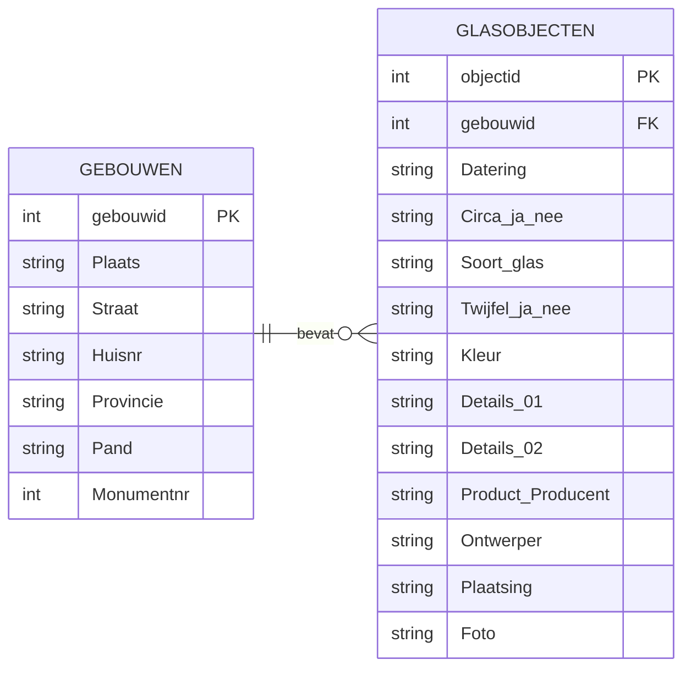

:::::::::::::::::::::::::::::::::::::: questions 

- Hoe pas ik wat ik nu weet over relationele databases toe op mijn eigen data?

::::::::::::::::::::::::::::::::::::::::::::::::

::::::::::::::::::::::::::::::::::::: objectives

- Het geleerde kunnen toepassen op je eigen data

::::::::::::::::::::::::::::::::::::::::::::::::

In deze module heb je een goed idee gekregen van het relationeel datamodel en databases.
Nu is het zaak dit toe te passen op je eigen dataset. 

::: callout
## Geen eigen dataset?
FIXME
Als je geen eigen dataset hebt om te gebruiken kun je gebruik maken van `???`.
[Volg hier de downloadinstructies](learners/setup.md#dataset-voor-de-afsluitende-opdracht).
:::

::: challenge

## Ontwerp een database structuur voor je eigen dataset

Bekijk onderstaand *Entity Relation Diagram* (ERD) van de glas in gebouwen dataset die we tot nu toe hebben gebruikt.

Gebruik voor deze opdracht je eigen dataset of de backup-dataset hierboven.

Denk na over de structuur van een relationele database voor jouw dataset. Als jouw data al in een database staat,
denk dan na over verbeteringen in de structuur op basis van wat je in deze module hebt geleerd.
Teken op een vel papier een diagram voor de structuur die je hebt bedacht. 
Je mag hiervoor de stijl van bovenstaand diagram gebruiken, maar voel je vrij om het anders te doen, zolang het voor jou duidelijk is.

:::: solution

Bespreek je diagram met een mede-cursist die ook al klaar is met deze oefening, of met de docent.
::::

:::

::::::::::::::::::::::::::::::::::::: keypoints 

- Use `.md` files for episodes when you want static content
- Use `.Rmd` files for episodes when you need to generate output
- Run `sandpaper::check_lesson()` to identify any issues with your lesson
- Run `sandpaper::build_lesson()` to preview your lesson locally

::::::::::::::::::::::::::::::::::::::::::::::::
